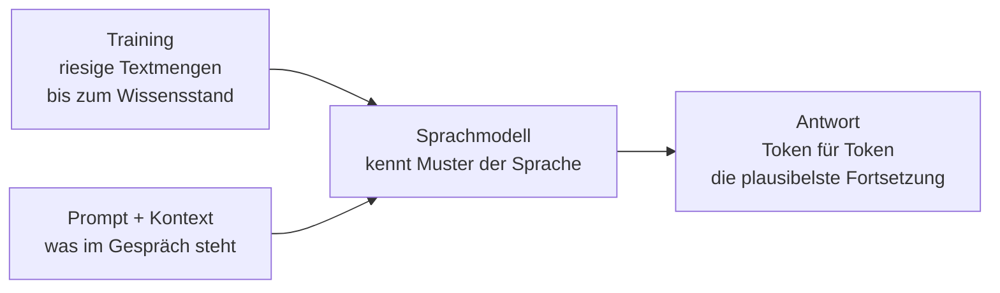

# Lab 1.2: Wie ein Sprachmodell antwortet

**Leitfragen:**

Wie schlägt die Tastatur am Smartphone das nächste Wort vor?

Sie hat gelernt, welche Wörter häufig aufeinander folgen, und zeigt die wahrscheinlichsten an. Ein Sprachmodell macht im Prinzip dasselbe – nur mit viel mehr Text und viel weiter vorausschauend.

Kann ein Programm einen Text schreiben, ohne ihn zu „verstehen"?

Ja. Ein Sprachmodell erzeugt Text, der plausibel klingt, weil er gelernten Mustern folgt. Ob der Inhalt stimmt, prüft es dabei nicht.

Woher sollte ein Programm wissen, was gestern passiert ist?

Gar nicht – außer jemand gibt es ihm mit, oder es darf im Web suchen. Das Wissen aus dem Training endet an einem Stichtag.

- Ein KI-Chat beruht auf einem Sprachmodell: Es sagt Stück für Stück die plausibelste Fortsetzung eines Textes voraus.
- Daraus folgen seine Stärken (flüssige Sprache) und seine Grenzen (erfundene Fakten, kein aktuelles Wissen).

## Begriffe

| Begriff | Bedeutung |
| ------- | --------- |
| Sprachmodell (LLM, Large Language Model) | KI, die aus riesigen Textmengen gelernt hat, wie Sprache aufgebaut ist, und darauf Text erzeugt |
| Training | die Lernphase vor der Nutzung: Das Modell liest sehr viele Texte und lernt Muster |
| Trainingsdaten | die Texte, aus denen das Modell gelernt hat (Bücher, Webseiten, Artikel u. a.) |
| Wissensstand | der Zeitpunkt, bis zu dem die Trainingsdaten reichen; danach kennt das Modell nichts mehr von selbst |
| Token | ein Textstückchen, etwa ein kurzes Wort oder eine Silbe; das Modell rechnet in Tokens |
| Prompt | die Eingabe, mit der das Modell gesteuert wird – Frage, Auftrag, Text |
| Kontext | alles, was dem Modell im Gespräch vorliegt: Prompt, bisheriger Verlauf, eingefügte Texte |
| Halluzination | eine überzeugend klingende, aber erfundene Aussage |

## Vom Training zur Antwort

Im Training liest das Modell riesige Textmengen aus Web, Büchern und Code. Dabei sagt es immer wieder das nächste Token voraus und lernt aus jedem Fehler. Das Ergebnis ist ein Basismodell, das Text fortsetzen kann; ein Nachtraining macht daraus einen hilfreichen Assistenten (siehe Vertiefung).

Das Bild dazu: **Autovervollständigung am Smartphone – nur viel größer.** Die Tastatur schlägt ein Wort vor; das Sprachmodell setzt Token für Token fort, bis eine ganze Antwort entsteht. Jedes neue Token hängt von allem ab, was davor steht.

Beispiel: Auf „Die Hauptstadt von Frankreich ist" folgt mit sehr hoher Wahrscheinlichkeit „Paris". Auf „Die Gründerin der Firma XY war" folgt ein plausibel klingender Name – auch wenn das Modell die Firma nie gesehen hat.

Ein echtes Beispiel aus dem Jahr 2023: ChatGPT soll einen Zeitungsartikel zusammenfassen, bekommt aber nur den Link und hat keine Websuche. Statt zu sagen, dass es den Artikel nicht lesen kann, erfindet es aus den Wörtern im Link eine flüssige, sachlich klingende Zusammenfassung – eine Halluzination.

_Quelle: Wikimedia Commons, „ChatGPT hallucination.png“ (https://commons.wikimedia.org/wiki/File:ChatGPT_hallucination.png), Public Domain, Ansicht März 2023, abgerufen am 09.11.2026._

## Kontext ist alles – erste Form

Ein Sprachmodell kennt genau zwei Dinge:

| Quelle | Beispiel | Grenze |
| ------ | -------- | ------ |
| Training | allgemeines Wissen, Sprache, Stil | endet am Wissensstand, enthält keine internen Firmendaten |
| Kontext im Gespräch | eingefügte Mail, Frage, bisheriger Chatverlauf | nur, was tatsächlich drinsteht |

Was weder im Training noch im Kontext steht, ergänzt das Modell durch Plausibles. Darum entscheidet der mitgegebene Kontext stark über die Qualität der Antwort – vertieft in Modul 4.

## Vier Folgen für die Praxis

| Folge | Warum | Was das bedeutet |
| ----- | ----- | ---------------- |
| wahrscheinlich statt richtig | das Modell wählt plausible Fortsetzungen, es prüft keine Fakten | Zahlen, Namen, Quellen können erfunden sein (Halluzination) |
| jedes Mal etwas anders | bei jeder Antwort wird mit etwas Zufall aus den wahrscheinlichen Tokens gewählt | derselbe Prompt liefert zwei verschiedene Formulierungen |
| Wissen mit Stichtag | Training endet am Wissensstand | Aktuelles fehlt, außer eine Websuche ist zugeschaltet |
| klingt immer sicher | der Ton folgt Mustern, nicht dem Wissen | sicherer Ton ist kein Zeichen für Richtigkeit |

Viele KI-Chats können zusätzlich im Web suchen und zeigen dann Quellen an. Das hilft bei aktuellen Fragen, ersetzt aber nicht das Prüfen: Auch eine Antwort mit Quelle kann die Quelle falsch wiedergeben.

So sieht das zum Beispiel in Microsoft Copilot aus: Unter „Sources“ steht die Websuche, die der KI-Chat selbst ausgelöst hat, darunter die nummerierten Quellen, auf die sich die Antwort stützt.

_Quelle: Microsoft Learn, „Data, privacy, and security for web search in Microsoft Copilot and Microsoft Copilot Chat“ (https://learn.microsoft.com/en-us/copilot/microsoft-365/manage-public-web-access), © Microsoft, Stand 29.10.2026, abgerufen am 09.11.2026._

> **Merksatz:** Ein Sprachmodell liefert die wahrscheinlichste, nicht die richtige Antwort. Die Prüfung bleibt beim Menschen.

## Vertiefung

- **Warum „Large":** Heutige Sprachmodelle haben Milliarden von Parametern (einstellbare Zahlen im neuronalen Netz) und wurden mit einem großen Teil des öffentlich verfügbaren Textes trainiert.
- **Nachtraining:** Nach dem Grundtraining werden Modelle mit menschlichem Feedback so angepasst, dass sie hilfreich antworten und schädliche Anfragen ablehnen. Das verändert den Stil, nicht das Grundprinzip der Vorhersage.
- **Drei Trainingsstufen im Überblick:** Stufe 1 „Pretraining“ (Vortraining: nächstes Token vorhersagen, Ergebnis ist ein Basismodell), Stufe 2 „Supervised Fine-Tuning“ (das Modell lernt an Beispielantworten, Anweisungen zu befolgen), Stufe 3 „Reinforcement Learning from Human Feedback“ (Menschen bewerten mehrere Antworten, das Modell lernt, die bevorzugten zu geben).

_Quelle: Wikimedia Commons, „Three-stage large language model training workflow.svg“ (https://commons.wikimedia.org/wiki/File:Three-stage_large_language_model_training_workflow.svg), Kjerish, CC0, abgerufen am 09.11.2026._
- **Zufall einstellen:** Fachleute steuern den Zufall über die sogenannte Temperatur; in normalen KI-Chats ist sie nicht sichtbar.

## Fazit

- Ein Sprachmodell setzt Text Token für Token mit der plausibelsten Fortsetzung fort.
- Es kennt nur Training und Kontext; alles andere wird plausibel ergänzt.
- Halluzinationen, wechselnde Antworten und fehlendes aktuelles Wissen folgen direkt aus diesem Prinzip.

In der Übung werden genau diese Grenzen mit drei vorbereiteten Prompts sichtbar gemacht.
