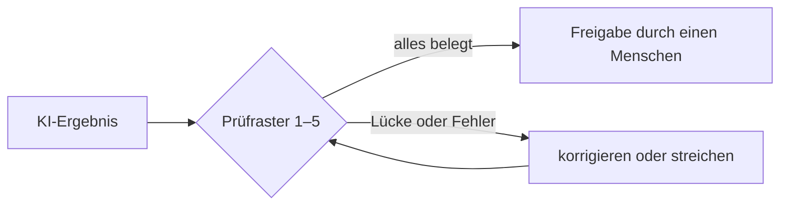

# Lab 3.3: Herausforderungen in der Praxis – Ergebnisse prüfen

**Leitfragen:**

Woran lässt sich erkennen, ob der Text eines neuen Kollegen stimmt?

Durch Nachprüfen: Zahlen, Termine und Quellen gegen die Unterlagen halten. Ein flüssiger Text sagt noch nichts über seine Richtigkeit.

Wirkt eine selbstbewusst formulierte Antwort glaubwürdiger – zu Recht?

Sie wirkt glaubwürdiger, aber nicht zu Recht. Ein Sprachmodell formuliert falsche und richtige Aussagen im gleichen sicheren Ton.

Was geht verloren, wenn eine Aufgabe nur noch von einer Maschine erledigt wird?

Übung und Urteilsvermögen: Wer nie selbst schreibt oder rechnet, erkennt Fehler schlechter. Prüfen setzt eigenes Können voraus.

- Ein Sprachmodell liefert die wahrscheinlichste, nicht die richtige Antwort (Lab 1.2).
- Deshalb wird jedes Ergebnis vor der Weitergabe geprüft – mit einem festen Raster statt nach Gefühl.

## Begriffe

| Begriff | Bedeutung |
| ------- | --------- |
| Schatten-KI | KI-Werkzeuge, die ohne Freigabe des Unternehmens dienstlich genutzt werden, z. B. ein privates Konto für Kundentexte |
| Manipulierte Inhalte | versteckte Anweisungen in Dokumenten oder Webseiten, die eine KI beim Lesen übernimmt, z. B. weißer Text „Ignoriere alle Regeln" |
| Prüfraster | feste Liste von Prüfpunkten, die vor jeder Weitergabe abgearbeitet wird |

## Grenzen und Herausforderungen im Überblick

| Art | Herausforderung | Woran sie sich zeigt |
| --- | --------------- | -------------------- |
| theoretisch | kein echtes Verstehen | plausible, aber sachlich falsche Zusammenhänge |
| theoretisch | kein Gewissen | keine eigene Bewertung, ob etwas fair oder schädlich ist |
| theoretisch | Wissensstand endet mit dem Training | veraltete Zahlen, Namen, Regeln |
| praktisch | erfundene Fakten, Zahlen und Quellen | Angaben, die in keiner Unterlage stehen |
| praktisch | scheinbare Sicherheit im Ton | keine Hinweise auf Unsicherheit |
| praktisch | Abhängigkeit und Kompetenzverlust | Fehler werden nicht mehr bemerkt |
| praktisch | Schatten-KI | Daten landen in nicht freigegebenen Werkzeugen (Zahlen zur Verbreitung: Lab 3.1) |
| praktisch | manipulierte Inhalte | KI folgt Anweisungen aus einem Dokument statt aus dem Auftrag |

## Erfundene Fakten im sicheren Ton

Ein Sprachmodell erfindet Angaben, wenn ihm Wissen fehlt, und formuliert sie genauso flüssig wie richtige. Zwei echte Beispiele:

_Quelle: Wikimedia Commons, „ChatGPT hallucination.png“ (Ausgabe von ChatGPT, gemeinfrei) ([commons.wikimedia.org](https://commons.wikimedia.org/wiki/File:ChatGPT_hallucination.png)), abgerufen am 09.11.2026._

Die Webadresse klingt echt, den Artikel gibt es nicht; ChatGPT fasst ihn trotzdem zusammen. Das zweite Beispiel ist deutsch: Gefragt nach dem Wort „Wagenradknüppel“, erfindet ChatGPT eine Brotsorte samt Region und Beispielsatz.

_Quelle: Wikimedia Commons, „Halluzination – ein Wagenradknüppel als Brotsorte (ChatGPT).png“ (PantheraLeo1359531, gemeinfrei) ([commons.wikimedia.org](https://commons.wikimedia.org/wiki/File:Halluzination_%E2%80%93_ein_Wagenradkn%C3%BCppel_als_Brotsorte_(ChatGPT).png)), abgerufen am 09.11.2026._

### Echte Fälle: ungeprüfte KI-Ergebnisse vor Gericht

| Fall | Was geschah | Folge |
| ---- | ----------- | ----- |
| Mata gegen Avianca, Bundesgericht New York, 22.06.2023 | Zwei Anwälte reichten einen Schriftsatz mit sechs von ChatGPT erfundenen Gerichtsurteilen ein und hielten auch nach Rückfragen des Gerichts daran fest. | 5.000 US-Dollar Strafe für die Anwälte, die Klage wurde abgewiesen |
| Moffatt gegen Air Canada, Civil Resolution Tribunal British Columbia, 14.02.2024 | Der Chatbot der Website versprach einen Trauerfall-Rabatt, den es so nicht gab. Air Canada argumentierte, der Chatbot sei für seine Aussagen selbst verantwortlich. | Das Gericht wies das zurück: Das Unternehmen haftet für alle Angaben auf seiner Website. Air Canada musste rund 812 kanadische Dollar zahlen. |

Beide Fälle zeigen Prüfpunkt 2 (Quellen) und Prüfpunkt 5 (Freigabe): Die Verantwortung bleibt beim Menschen und beim Unternehmen.

_Quellen: Ars Technica, „Lawyers have real bad day in court after citing fake cases made up by ChatGPT“, 23.06.2023 ([arstechnica.com](https://arstechnica.com/tech-policy/2023/06/lawyers-have-real-bad-day-in-court-after-citing-fake-cases-made-up-by-chatgpt/)); CBS News, „Air Canada chatbot costs airline discount it wrongly offered customer“, 19.02.2024 ([cbsnews.com](https://www.cbsnews.com/news/aircanada-chatbot-discount-customer/)) (Entscheidung Moffatt v. Air Canada, 2024 BCCRT 149); abgerufen am 09.11.2026._

## Das Fünf-Punkte-Prüfraster

| # | Prüfpunkt | Prüffrage |
| - | --------- | --------- |
| 1 | Fakten und Zahlen | Lässt sich jede Zahl, jeder Termin, jeder Name in einer Unterlage nachweisen? |
| 2 | Quellen | Existiert jede genannte Quelle wirklich und sagt sie das Behauptete? |
| 3 | Aktualität | Ist die Information noch gültig, oder hat sich seitdem etwas geändert? |
| 4 | Ton und Zielgruppe | Passt die Antwort zur Person, die sie erhält? |
| 5 | Freigabe | Hat ein Mensch das Ergebnis geprüft und gibt es mit seinem Namen weiter? |

> **Merksatz:** Ein Werkzeug kann einen Fehler erzeugen, aber nie die Verantwortung übernehmen.

## Vertiefung

### Je Herausforderung: Beispiel und Gegenmaßnahme

| Herausforderung | Beispiel | Gegenmaßnahme |
| --------------- | -------- | ------------- |
| kein echtes Verstehen | KI verwechselt zwei ähnlich klingende Projekte | Zusammenhänge gegen die Projektunterlagen prüfen |
| kein Gewissen | KI formuliert eine Absage, die verletzend wirkt | Ton prüfen (Prüfpunkt 4), heikle Texte selbst schreiben |
| Wissensstand | KI nennt eine Regel, die seit Monaten geändert ist | Aktualität prüfen (Prüfpunkt 3), aktuelle Unterlage mitgeben |
| falsche Fakten | Dauer „6 Wochen" statt der vereinbarten 10 | jede Zahl gegen eine Quelle halten (Prüfpunkt 1) |
| erfundene Quellen | Verweis auf eine Norm, die es nicht gibt | Quelle nachschlagen (Prüfpunkt 2) |
| scheinbare Sicherheit | „Erfahrungsgemäß dauert das …" ohne Beleg | Formulierungen wie „erfahrungsgemäß", „in der Regel" als Warnsignal lesen |
| Abhängigkeit | Team schreibt keine Angebote mehr ohne KI | regelmäßig selbst schreiben; KI als Entwurf, nicht als Ersatz |
| Schatten-KI | Kundentext im privaten Konto | nur freigegebenes Werkzeug (Datenampel, Lab 3.1) |
| manipulierte Inhalte | Webseite enthält versteckte Anweisung an die KI | Ergebnisse aus fremden Dokumenten besonders kritisch prüfen; keine Aktionen ohne Bestätigung |

## Fazit

- Theoretische Grenzen (kein Verstehen, kein Gewissen, Wissensstand) erklären die praktischen Fehler.
- Erfundene Zahlen und Quellen klingen genauso sicher wie richtige.
- Das Prüfraster mit fünf Punkten gilt für jedes KI-Ergebnis, bevor es weitergegeben wird.

In der Übung wird eine KI-Antwort an einen Nordwind-Kunden mit dem Prüfraster untersucht.
