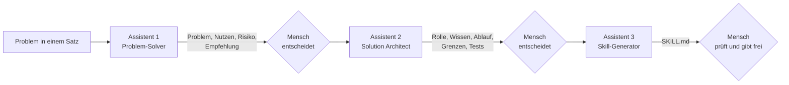

# Lab 4.3: Kontext ist alles: KI nutzen, um KI zu bauen

**Leitfragen:**

<details>
<summary>Was müsste eine Urlaubsvertretung jedes Mal neu erklärt bekommen – und was könnte stattdessen auf einem Merkzettel stehen?</summary>

Abläufe, Regeln, Ansprechpersonen und Beispiele. Alles, was sich nicht ändert, gehört auf den Merkzettel; nur der aktuelle Fall wird noch erklärt.

</details>

<details>
<summary>Ist es angenehm oder eher unheimlich, wenn ein Werkzeug sich an frühere Gespräche erinnert?</summary>

Beides. Angenehm, weil nichts wiederholt werden muss; unheimlich, wenn unklar ist, was gespeichert wird. Deshalb muss das Gemerkte einsehbar und löschbar sein.

</details>

<details>
<summary>Könnte ein KI-Werkzeug die Arbeitsanweisung für ein anderes KI-Werkzeug schreiben – und wer sollte sie prüfen?</summary>

Ja, aus einer Problembeschreibung und Beispielen. Prüfen und freigeben muss ein Mensch, der das Problem versteht.

</details>

- Ein Modell weiß nur, was im Training, im Prompt und im mitgegebenen Kontext steht (Lab 1.2). Darum entscheidet der Kontext über die Qualität – nicht das Werkzeug.
- Rolle, Regeln und Beispiele jedes Mal neu zu tippen ist mühsam und fehleranfällig. Die Lösung: Kontext einmal aufschreiben und wiederverwenden.

## Begriffe

| Begriff | Bedeutung |
| ------- | --------- |
| Markdown (`.md`) | einfache Textdatei, in der `#` eine Überschrift und `-` einen Listenpunkt markiert; Menschen und KI lesen sie gleich gut |
| Anweisungsdatei | dauerhafte Regeln für ein KI-Werkzeug, z. B. benutzerdefinierte Anweisungen oder Projektanweisungen – wie ein Merkzettel für die Urlaubsvertretung |
| Memory | Gedächtnisfunktion: das Werkzeug merkt sich einzelne Fakten über die Person aus früheren Gesprächen |
| Skill | Ordner mit einer Datei `SKILL.md`: Name, Beschreibung, Anweisungen; der Assistent lädt ihn nur, wenn die Aufgabe zur Beschreibung passt |
| Agent | eigener Assistent mit festem Zweck, festen Anweisungen und eigenem Wissen, z. B. für wiederkehrende Fragen |

## Die Kontext-Treppe

```text
                                    ┌── 4  Eigener Assistent (Agent)
                                    │      Anweisungen + Wissen + Skills, dauerhaft für viele
                        ┌── 3  Wiederverwendbarer Kontext
                        │      .md-Anweisung, Memory, Skill: einmal schreiben, oft nutzen
            ┌── 2  Besserer Prompt
            │      vier Bausteine, Nachbessern (Lab 4.1–4.2)
┌── 1  Einzelner Prompt
│      einmal tippen, einmal nutzen
```

Jede Stufe nimmt der nächsten Arbeit ab. Ab Stufe 3 wird Kontext zu einer Datei, die sich prüfen, teilen und verbessern lässt.

## Markdown in einem Beispiel

```markdown
# Kundenmails beantworten        ← Überschrift

## Regeln                        ← Unterüberschrift
- höchstens sechs Sätze          ← Listenpunkt
- keine Termine erfinden
```

Eine `.md`-Datei lässt sich mit jedem Texteditor öffnen und speichern (Editor unter Windows, TextEdit unter macOS im Modus „Reiner Text").

## Drei Formen von wiederverwendbarem Kontext

| Form | Was es ist | Gut für | Achtung |
| ---- | ---------- | ------- | ------- |
| Anweisungsdatei | dauerhafte Regeln, in jedem neuen Chat eingefügt oder im Werkzeug hinterlegt | Rolle, Ton, Format, feste Regeln | nur Regeln, keine wechselnden Fälle |
| Memory | einzelne Fakten über die Person, die das Werkzeug sich merkt | Rolle, Vorlieben, wiederkehrende Angaben | einsehbar und löschbar halten; Datenampel gilt |
| Skill | Ordner mit `SKILL.md`, lädt nur bei passender Aufgabe | Aufgaben-Know-how, z. B. „Reisekostenfragen beantworten" | Beschreibung muss genau sagen, wann der Skill gilt |

### Beispiel: Anweisungsdatei

Eine Anweisungsdatei für Kundenmails (vollständig in `output/project/beispiel-kontext-baustein.md`):

```markdown
# Mein Kontext-Baustein: Kundenmails beantworten

## Rolle
Du bist Projektassistenz bei [Firma] und beantwortest Kundenmails freundlich,
klar und verbindlich.

## Regeln
- Beantworte jede Frage aus der Mail einzeln.
- Verwende nur Fakten aus „Was wir wissen"; erfinde keine Termine oder Zahlen.
- Fehlt eine Information, schreibe „[offen: …]".

## Format der Antwort
- Betreffzeile mit „Re:", höchstens sechs Sätze
- am Ende: Liste „Zu prüfen vor Versand"
```

Viele Werkzeuge haben ein eigenes Feld, in dem solche Regeln dauerhaft hinterlegt werden, z. B. für einen eigenen Assistenten (Agent) oder ein Projekt; sie gelten dann in jedem Chat damit. Zwei Beispiele:


_Quelle: Microsoft Learn, „Build agents in Agent Builder" (https://learn.microsoft.com/en-us/microsoft-365/copilot/extensibility/agent-builder-build-agents), abgerufen am 09.11.2026._


_Quelle: Anthropic, „Collaborate with Claude on Projects" (https://www.anthropic.com/news/projects), abgerufen am 09.11.2026._

Bietet ein Werkzeug kein solches Feld, wird die `.md`-Datei am Anfang jedes neuen Chats eingefügt.

### Memory: praktisch, aber kontrolliert

- Viele Chat-Werkzeuge bieten eine Gedächtnisfunktion; der Name unterscheidet sich je Werkzeug (z. B. „Memory", „Speicher", „Erinnerungen").
- Gemerkt wird je nach Werkzeug automatisch oder nach ausdrücklicher Bitte („Merke dir, dass …").
- In den Einstellungen lassen sich gemerkte Einträge ansehen, korrigieren und löschen; die Funktion lässt sich meist ganz abschalten.
- Datenampel aus Lab 3.1: Nichts Rotes ins Memory – auch keine Angaben über Dritte.
- In Unternehmenskonten kann die IT die Funktion für alle abschalten (Beispiel: Microsoft 365 Copilot).

So sieht das Merken auf ausdrückliche Bitte aus: In Le Chat von Mistral zählt eine Person ihre Vorlieben auf und bittet, sie zu speichern; das Werkzeug bestätigt und fasst das Gemerkte als Tabelle zusammen.


_Quelle: Screenshot VulcanSphere, Public Domain, Wikimedia Commons (https://commons.wikimedia.org/wiki/File:Le_Chat_chatbot_memories_screenshot.webp), abgerufen am 09.11.2026._

Funktionsnamen und Verfügbarkeit je Werkzeug: Stand 09.11.2026, vor Kursbeginn prüfen.

### Beispiel: Skill

Ein Skill ist ein Ordner. Seine Datei `SKILL.md` beginnt mit einem Kopfbereich zwischen `---`, den der Assistent zuerst liest:

```markdown
---
name: nordwind-reisekosten                    ← kurzer Name, Kleinbuchstaben und Bindestriche
description: Beantwortet Fragen zur Reise-     ← entscheidet, WANN der Skill geladen wird
  kostenabrechnung bei Nordwind (Genehmigung,
  Bahnklasse, Hotel, Belege, Fristen) auf Basis
  der Reisekostenrichtlinie. Verwenden, wenn
  jemand nach Dienstreisen oder Belegen fragt.
---

# Nordwind-Reisekosten beantworten             ← ab hier: die eigentliche Anleitung

## Wissensquelle
Antworte ausschließlich auf Basis der Datei `nordwind-reisekosten-richtlinie.md`.
Erfinde keine Beträge, Fristen oder Regeln.

## Vorgehen
1. Frage einem Abschnitt der Richtlinie zuordnen.
2. Regel in einem Satz nennen.
3. Nächsten Schritt nennen.
4. Abschnitt als Quelle angeben.

## Format der Antwort
- höchstens fünf Sätze, am Ende: `Quelle: Reisekostenrichtlinie, Abschnitt <Nr.>`
```

Vollständige Datei: `output/project/skills/nordwind-reisekosten/SKILL.md`. Der Ordner kann zusätzlich Vorlagen oder Beispieldateien enthalten.

Denselben Aufbau zeigt das Beispiel des Herstellers: oben der Kopfbereich mit `name` und `description`, darunter die Anleitung in Markdown.


_Quelle: Anthropic Engineering, „Equipping agents for the real world with Agent Skills" vom 16.10.2025 (https://www.anthropic.com/engineering/equipping-agents-for-the-real-world-with-agent-skills), abgerufen am 09.11.2026._

- Der Assistent liest zuerst nur `name` und `description` aller Skills. Erst wenn eine Frage passt, lädt er die vollständige Anleitung. So bleiben viele Skills verfügbar, ohne den Kontext zu füllen.
- Das Format hat Anthropic im Oktober 2025 für Claude eingeführt und im Dezember 2025 als offenen Standard veröffentlicht; inzwischen unterstützen es viele KI-Werkzeuge (Quellen: [agentskills.io](https://agentskills.io/), [claude.com/blog/skills](https://claude.com/blog/skills), abgerufen am 09.11.2026). Ob und wie ein Werkzeug Skills hochladen lässt, unterscheidet sich; Stand 09.11.2026, vor Kursbeginn prüfen.

In Claude stehen Skills in den Einstellungen als Liste, jeder mit Schalter zum Ein- und Ausschalten und einer Schaltfläche zum Hochladen. Einer der mitgelieferten Skills heißt `skill-creator`: ein Skill, der beim Schreiben neuer Skills hilft – KI baut KI.


_Quelle: Claude Blog, „Introducing Agent Skills" vom 16.10.2025 (https://claude.com/blog/skills), abgerufen am 09.11.2026._

## KI nutzen, um KI zu bauen

Die Anweisungen für einen Assistenten muss niemand von Hand schreiben. Eine KI entwirft sie aus Problem und Beispielen – der Mensch führt:

```text
1. Problem verstehen   →   2. Lösung konzipieren   →   3. Lösung bauen
   (ohne Lösungsidee)         (Bausteine, Grenzen)        (Anweisung, SKILL.md)
        ▲                          ▲                          ▲
        └──────── der Mensch entscheidet an jedem Übergang ───┘
```

Umgesetzt als Kette aus drei spezialisierten Assistenten; jeder bekommt das Ergebnis des vorherigen:



### Beispiel: Reisekostenfragen bei Nordwind

| Schritt | Ergebnis | Entscheidung des Menschen |
| ------- | -------- | ------------------------- |
| Problem | „Neue Mitarbeitende stellen jede Woche dieselben Fragen zur Reisekostenabrechnung." | – |
| Assistent 1 | Assistent, der nur aus der Richtlinie antwortet und die Quelle nennt; Erfolg: 80 % der Standardfragen ohne Mail an Finanzen | Gehaltsfragen und Einzelfälle ausgeschlossen |
| Assistent 2 | Rolle, Wissensquelle, Ablauf in vier Schritten, Grenzen, drei Testfragen | Testfrage „außerhalb der Richtlinie" ist Pflicht |
| Assistent 3 | `skills/nordwind-reisekosten/SKILL.md` | geprüft mit dem Prüfraster aus Lab 3.3 |

Mit und ohne Skill auf die Frage „Welche Belege brauche ich für eine Bahnfahrt?":

| Ohne Skill | Mit Skill |
| ---------- | --------- |
| allgemeine Antwort zu Fahrkarten und Steuer, „je nach Arbeitgeber"; keine Frist, keine Quelle | Fahrkarte oder Buchungsbestätigung als PDF, Foto genügt, Abrechnung binnen 30 Tagen; Quelle: Abschnitt 4 und 5 |

Alle Zwischenstände: `output/project/kette-zwischenstaende.md`; die drei Assistenten-Prompts: `anhang-assistenten-prompts.md` in diesem Modul.

> **Merksatz:** Die KI schreibt die Anweisung – der Mensch entscheidet, welches Problem gelöst wird, und gibt das Ergebnis frei.

## Typische Fehler

| Symptom | Ursache | Lösung |
| ------- | ------- | ------ |
| Anweisungsdatei wirkt kaum | Regeln zu allgemein („sei professionell") | konkrete, prüfbare Regeln und ein Beispiel |
| Skill wird nie verwendet | `description` sagt nicht, wann er gilt | Auslöser nennen („Verwenden, wenn …") |
| Datei enthält echte Kundendaten | Vorlage nicht anonymisiert | nur Platzhalter `[…]` – Datenampel |
| `.md`-Datei öffnet sich als formatiertes Dokument | Editor im Rich-Text-Modus | als reinen Text speichern |

## Fazit

- Kontext entscheidet über die Qualität; wiederverwendbarer Kontext spart Tipparbeit und Fehler.
- Drei Formen: Anweisungsdatei (Regeln), Memory (Fakten über die Person), Skill (Aufgaben-Know-how, lädt bei Bedarf).
- KI kann Anweisungen und Skills selbst entwerfen; der Mensch versteht das Problem und gibt frei.

In der Übung entsteht aus der Prompt-Vorlage von Lab 4.2 ein eigener Kontext-Baustein als `.md`-Datei.
